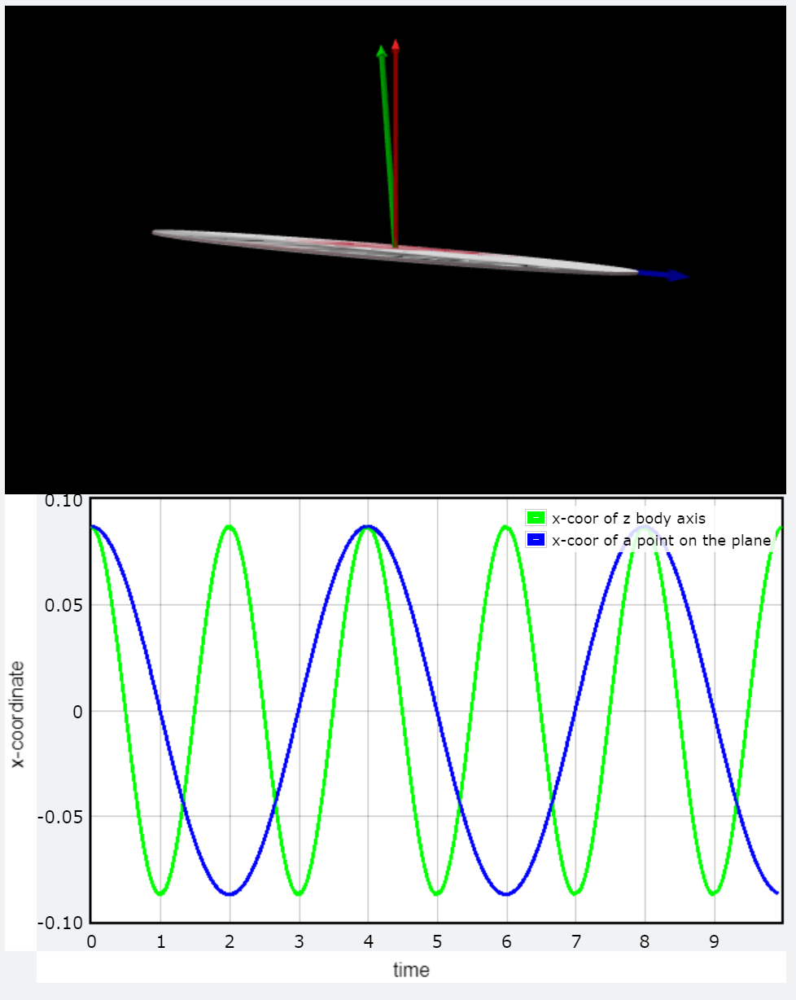

# Feynman's Wobbling Plate

A visual exploration of a spinning plate, built with **Python and VPython**.



## Inside the simulation

- A textured 3D plate and colored markers for its orientation.
- Separate rotations for the plate and an axis marker.
- Time-dependent plots of two x-coordinate signals.

The animation illustrates the relationship between spin and wobble. The rotation rates are prescribed in the code; this is an educational visualization rather than a general rigid-body dynamics solver.

## Run locally

Use a Python environment with a graphical browser available for VPython.

```bash
git clone https://github.com/oonacitarhan/Feynmans-Wobbling-Plate.git
cd Feynmans-Wobbling-Plate
python3 -m venv .venv
source .venv/bin/activate
python -m pip install -r requirements.txt
python sim.py
```

On Windows, activate the environment with `.venv\Scripts\activate`.

## Explore the code

The simulation lives in [sim.py](sim.py). The main parameters are:

| Parameter | Role |
| --- | --- |
| `dt` | Time increment per loop, initially `0.01`. |
| `v` | Rotation-rate parameter, initially `pi / 2`. |
| `omega` | Angle-related parameter used in marker setup. |

The animation continues in a loop. Plot collection stops after the simulation time reaches 10 to limit plotting overhead.

## Model note

The original implementation uses a small-angle approximation, while `omega = pi / 2` was chosen for demonstration. Treat the visualization as an illustration of the intended motion, not a numerical validation of the approximation.
